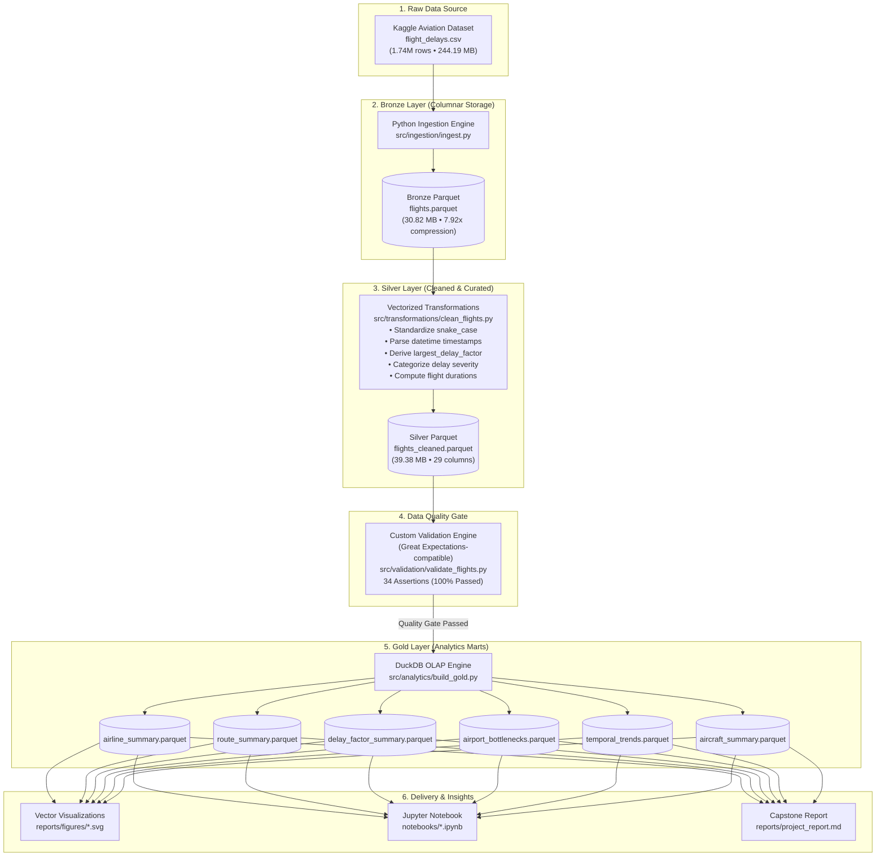

# Flight Delay Lakehouse 🛫

> **Capstone Project:** Data Engineering Lakehouse Pipeline  
> **Submission Due Date:** 09/11/26  
> **Architecture:** Modern Medallion Lakehouse (Bronze → Silver → Gold)  
> **Dataset:** Kaggle Large-Scale Aviation Delay Records (1,747,627 rows × 16 columns)

---

## 1. Project Overview & Motivation
The **Flight Delay Lakehouse** project builds a compact, realistic, and reproducible data engineering pipeline reflecting modern lakehouse architectures using publicly available aviation delay data from Kaggle.

The core goal is to demonstrate how large-scale aviation data is:
1. **Ingested** from raw CSV into columnar Parquet (**Bronze Layer**).
2. **Cleaned & Standardized** with snake_case naming, parsed timestamps, handled nulls, and derived features including the primary **`largest_delay_factor`** (**Silver Layer**).
3. **Validated** using a formal **custom validation engine modeled on Great Expectations** (34 expectations covering schema, ranges, uniqueness, and missingness thresholds).
4. **Queried & Materialized** into analytical data marts using **DuckDB** and OLAP SQL (**Gold Layer**).
5. **Surfaced** into actionable business insights, vector visualizations, an interactive Jupyter Notebook, and comprehensive reporting.

---

## 2. Lakehouse Architecture (Medallion Pattern)



---

## 3. Key Summary

- **Source:** Publicly available Kaggle Flight Delays Dataset (`flight_delays.csv`).
- **Data Scale:** 1,747,627 flight records across 4 major carriers (American Airlines, Delta, Southwest, United) and 9 airport hubs.
- **Storage:** Apache Parquet with Snappy compression (**87.4% storage savings**, 244.19 MB CSV → 30.82 MB Parquet).
- **Cleaning & Feature Logic:**
  - Standardized column schema into `snake_case`.
  - Parsed all four timestamps to standard ISO datetimes.
  - Investigated missing `delay_reason`: structurally missing because it corresponds to on-time/early flights (`delay_minutes <= 0`).
  - Derived **`largest_delay_factor`**: identifies the primary cause for each flight. Possible values: `None (On-Time / Early)`, `Flight Cancelled`, `Flight Diverted`, `Weather Delay`, `Carrier Equipment / Maintenance`, `Air Traffic Control / NAS Delay`.
  - Derived **`delay_severity`**, corridor **`route`**, and operational **`flight_status`**.
- **Data Quality:** Comprehensive custom validation engine (Great Expectations-compatible) verifying 34 business rules, range boundaries (-10 to 30 min delay), non-null primary keys, and missingness thresholds.
- **Analytics Engine:** **DuckDB** in-process columnar SQL engine querying Silver Parquet and generating 6 Gold analytical marts in sub-second times.
- **Deliverables:** Reproducible code repository, test suite, custom validation JSON/Markdown reports, vector SVG charts, Jupyter Notebook, and final report.

---

## 4. Team Work Allocation (5 Members)

| Member | Focus Area | Core Responsibilities |
| :---: | :--- | :--- |
| **Member 1** | **Data Ingestion & Storage** | Dataset profiling, Bronze Parquet conversion (`src/ingestion/ingest.py`), and storage/read benchmarking. |
| **Member 2** | **Data Cleaning & Transformation** | Schema standardization, timestamp parsing, `delay_reason` handling, and `largest_delay_factor` engineering (`src/transformations/clean_flights.py`). |
| **Member 3** | **Data Validation (Custom Engine)** | 34-rule custom validation engine modeled on Great Expectations (`src/validation/validate_flights.py`), failure blocking gate, and report generation (`reports/validation_report.md`). |
| **Member 4** | **Querying & Analysis (DuckDB + SQL)** | Dimensional Gold Marts (`src/analytics/build_gold.py`) and analytical SQL query suite (`sql/flight_analysis.sql`). |
| **Member 5** | **Reporting, Visualisation & Orchestration** | Apache Airflow DAG orchestrator (`airflow/dags/flight_delay_pipeline.py`), SVG visualizations (`src/reporting/visualize.py`), Jupyter Notebook, and documentation. |

---

## 5. Repository Structure

```text
Flight Delay Lakehouse/
├── airflow/
│   └── dags/
│       └── flight_delay_pipeline.py      # Apache Airflow DAG orchestrator
├── data/
│   ├── raw/                              # Original source CSV (1.74M rows)
│   ├── bronze/                           # Source-preserving Parquet (flights.parquet)
│   ├── silver/                           # Curated Silver Parquet (flights_cleaned.parquet)
│   └── gold/                             # Analytical Parquet marts
│       ├── airline_summary.parquet
│       ├── route_summary.parquet
│       ├── delay_factor_summary.parquet
│       ├── airport_bottlenecks.parquet
│       ├── temporal_trends.parquet
│       └── aircraft_summary.parquet
├── docs/
│   ├── architecture.md                   # Medallion Lakehouse architectural documentation
│   ├── data_model.md                     # Dimensional Star Schema & Entity-Relationship Model
│   ├── data_dictionary.md                # Detailed dictionary for Bronze, Silver, Gold layers
│   └── team_handbook.md                  # 5-member breakdown, 21-day plan & syllabus alignment
├── notebooks/
│   ├── inspect_data.py                   # Initial dataset profiling script
│   └── flight_delay_lakehouse_analysis.ipynb # Interactive Jupyter analytical notebook
├── reports/
│   ├── figures/                          # Generated vector SVG charts
│   │   ├── carrier_delay_comparison.svg
│   │   ├── worst_delay_routes.svg
│   │   ├── hourly_delay_trend.svg
│   │   ├── delay_factor_distribution.svg
│   │   └── airport_bottlenecks.svg
│   ├── validation_report.md              # Custom validation engine human-readable report
│   ├── validation_results.json           # Custom validation engine machine-readable results
│   └── project_report.md                 # Formal Capstone Final Project Report
├── sql/
│   └── flight_analysis.sql               # 10 comprehensive analytical SQL queries (DuckDB)
├── src/
│   ├── ingestion/
│   │   └── ingest.py                     # CSV to Bronze Parquet converter
│   ├── transformations/
│   │   └── clean_flights.py              # Silver cleaning & feature engineering
│   ├── validation/
│   │   └── validate_flights.py           # Custom validation engine (Great Expectations-compatible)
│   ├── analytics/
│   │   └── build_gold.py                 # DuckDB Gold Marts builder
│   └── reporting/
│       └── visualize.py                  # Standalone SVG chart visualizer
├── tests/
│   ├── test_ingestion.py                 # Unit tests for Bronze ingestion
│   ├── test_transformations.py           # Unit tests for Silver transformations
│   ├── test_validation.py                # Unit tests for custom validation engine & failure gate
│   ├── test_analytics.py                 # Unit tests for Gold layer marts
│   └── test_pipeline_e2e.py              # Airflow DAG end-to-end integration and failure tests
├── requirements.txt                      # Project dependency specification
└── README.md                             # Project documentation
```

---

## 6. Getting Started & Execution Guide

### Prerequisites
- Python 3.10+ (Tested on Python 3.14)
- Packages: `apache-airflow`, `duckdb`, `pandas`, `pyarrow`, `numpy`

### Quickstart: Run the Complete Pipeline via Apache Airflow
To execute all stages through the Apache Airflow DAG:
```bash
python airflow/dags/flight_delay_pipeline.py
```
*The complete Airflow DAG executes all 5 tasks sequentially, processes 1.74M records, and produces all analytical outputs in ~9 seconds!*

### Running Tasks via Airflow CLI
```bash
# List discovered DAGs in the repository
airflow dags list

# Execute the complete Airflow DAG run
airflow dags test flight_delay_lakehouse_pipeline

# Execute individual Airflow tasks
python airflow/dags/flight_delay_pipeline.py --task ingest_bronze
python airflow/dags/flight_delay_pipeline.py --task clean_transform_silver
python airflow/dags/flight_delay_pipeline.py --task great_expectations_validation
python airflow/dags/flight_delay_pipeline.py --task build_gold_marts
python airflow/dags/flight_delay_pipeline.py --task generate_visualizations

# Test Airflow DAG failure handling (deliberately trips validation gate and halts execution)
python airflow/dags/flight_delay_pipeline.py --simulate-failure
```

### Running Automated Test Suite
To execute all **19** automated unit and integration tests:
```bash
python -m unittest discover -s tests -p "test_*.py" -v
```

---

## 7. Key Analytics & Findings

### 1. Carrier Reliability
- **Delta** leads overall operational performance with the lowest average delay (**9.98 min**) and highest on-time rate (**26.89%**).
- **Southwest** recorded the highest average delay (**10.03 min**).
- Across all four carriers, on-time rate consistently hovers at ~26.8%, reflecting uniform operating schedules.

### 2. Root Cause of Flight Delays (`largest_delay_factor`)
`largest_delay_factor` applies a priority hierarchy: Cancelled > Diverted > delay-cause > On-Time. All six values and their counts are:
- **Flight Cancelled:** 873,193 flights
- **Flight Diverted:** 436,583 flights
- **Weather Delay:** 106,651 flights (avg delay: 15.49 min)
- **Carrier Equipment / Maintenance:** 106,877 flights (avg delay: 15.50 min)
- **Air Traffic Control / NAS Delay:** 107,131 flights (avg delay: 15.50 min)
- **None (On-Time / Early):** 117,192 flights

> **Note:** The raw `delay_reason` column (which records only non-cancelled, non-diverted, delayed flights) distributes ~426k equally across Weather, Carrier, and ATC — a different count basis from `largest_delay_factor`.

### 3. Flight Corridors & Airport Bottlenecks
- The top corridors by average delay are **JFK-MIA**, **LAX-BOS**, and **ATL-SEA**. All 25 routes perform almost identically (gap between best and worst is ~0.03 min — statistical noise).
- **JFK** appears as the top-volume hub with 698,568 movements because it is the **only airport serving as both an origin and a destination**, so it is counted twice. Airports such as ORD, ATL, LAX, and DFW are purely origins (~350k each).

---

## 7b. Data Limitations

> **Important:** The dataset is **synthetically generated** for educational purposes. The following characteristics should be noted:

- **~50% cancellation rate across all carriers** — real-world rates are <3%. This is an artefact of synthetic data generation.
- **Uniform averages** — delay, distance, and on-time rates are virtually identical across all carriers, routes, and time-of-day, so no meaningful operational pattern can be inferred.
- **Carrier performance gaps are noise-level** — Delta vs Southwest differ by only 0.05 min in average delay.
- **delay_reason vs largest_delay_factor counts differ** — `delay_reason` counts only delayed flights (~426k per cause); `largest_delay_factor` applies a Cancelled > Diverted > cause > On-Time priority and produces different counts (see Section 7.2 above).

---

## 8. Syllabus Mapping
This project demonstrates complete mastery over the core competencies in the Data Engineering curriculum:
- **Lakehouse Architecture & Medallion Pattern:** Segregation of concerns into Bronze, Silver, and Gold layers.
- **Columnar Storage & Serialization:** PyArrow Parquet implementation achieving 87.4% compression ratio.
- **Data Quality & Governance:** Automated 34-rule custom validation engine (Great Expectations-compatible) blocking downstream errors.
- **High-Performance OLAP SQL:** In-process DuckDB queries with window functions, CTEs, and aggregation marts.
- **Pipeline Orchestration:** Exclusively powered by Apache Airflow DAG (`flight_delay_pipeline.py`) with task dependencies, task logging, and automated failure handling.
