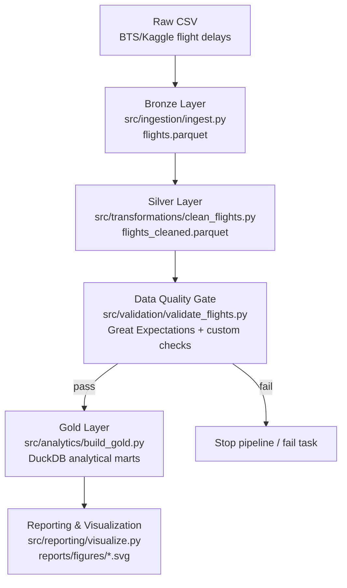

# Flight Delay Lakehouse 🛫

> **Capstone Project:** Data Engineering Lakehouse Pipeline  
> **Architecture:** Medallion Lakehouse (Bronze → Silver → Gold) on local Parquet + DuckDB  
> **Dataset:** U.S. DOT/BTS On-Time Performance flight delay records (Kaggle distribution; ~5.82M rows, 31 source columns)

---

## 1. Project Overview
This project implements a reproducible batch data engineering pipeline for large-scale aviation delay data using a modern lakehouse pattern:

1. **Bronze ingestion**: raw CSV is converted to source-preserving Parquet.
2. **Silver transformation**: columns are standardized, timestamps parsed, data typed, and analytical features derived (including `largest_delay_factor`, `flight_status`, `delay_severity`).
3. **Data quality validation**: a **Great Expectations framework** suite runs when the library is installed; the project also retains **custom GE-style checks** and a quality gate that blocks downstream processing on failure.
4. **Gold analytics marts**: DuckDB builds analytical summary tables as Parquet.
5. **Reporting/visualization**: SVG charts and reports are generated for analysis.

The implementation is intentionally lightweight (Python, Parquet, DuckDB, Airflow) and avoids unnecessary distributed frameworks for this dataset size.

---

## 2. Architecture (Medallion Pattern)



### Implemented layers
- **Bronze (`data/bronze/`)**: source-preserving Parquet from raw CSV.
- **Silver (`data/silver/`)**: cleaned/typed/enriched dataset (`flight_id`, parsed datetimes, route/time features, status and delay-factor features; handles aviation midnight HHMM `2400` rollover).
- **Gold (`data/gold/`)**: canonical analytical marts and materialized dimensions produced by `build_gold.py`:
  - `airline_summary.parquet`, `route_summary.parquet`, `delay_factor_summary.parquet`
  - `airport_bottlenecks.parquet`, `temporal_trends.parquet`, `aircraft_summary.parquet`
  - `dim_airline.parquet`, `dim_airport.parquet` (physical star-schema dimension alignment)

> Note: other `data/gold/*.parquet` files may exist from earlier experiments; marts/dims above are canonical outputs of the current implementation.

---

## 3. Airflow Orchestration
The pipeline is orchestrated by an Apache Airflow DAG:
- **DAG file:** `airflow/dags/flight_delay_pipeline.py`
- **DAG ID:** `flight_delay_lakehouse_pipeline`

### Tasks (sequential, with upstream failure blocking downstream)
1. `ingest_bronze` — Bronze ingestion
2. `clean_transform_silver` — Silver cleaning/transformation
3. `data_quality_validation` — Great Expectations + custom validation gate
4. `build_gold_marts` — DuckDB Gold mart generation
5. `generate_visualizations` — reporting figures

### Reliability/error handling (implemented)
- Task-level context/start/success/error logging in wrappers.
- `retry_delay` and retry settings in default args.
- `on_failure_callback` (`notify_failure`) logs failures and can POST to `PIPELINE_ALERT_WEBHOOK` if configured.
- Strict dependency chain prevents downstream execution when an upstream task fails.
- Validation CLI supports `--simulate-failure` for failure-path testing.

---

## 4. Data Quality Validation
Validation is implemented in `src/validation/validate_flights.py`.

- **Framework integration:** uses the **Great Expectations** API when installed (`great-expectations` dependency) to execute GX-native expectations.
- **Retained custom checks:** existing GE-style custom checks remain and run as supplemental validation.
- **Outputs:** JSON and Markdown reports in `reports/` with engine metadata (including GX availability/version when present).
- **Gate behavior:** validation raises/halts downstream processing on failure (and exits non-zero in CLI mode).

Run manually:
```bash
python src/validation/validate_flights.py --silver data/silver/flights_cleaned.parquet
python src/validation/validate_flights.py --simulate-failure   # failure-path test
```

---

## 5. Repository Structure (key paths)

```text
Flight Delay Lakehouse/
├── airflow/dags/flight_delay_pipeline.py      # Airflow DAG (orchestration)
├── src/
│   ├── ingestion/ingest.py                    # CSV -> Bronze Parquet
│   ├── transformations/clean_flights.py       # Bronze -> Silver Parquet
│   ├── validation/validate_flights.py         # GX framework + custom validation gate
│   ├── analytics/build_gold.py                # DuckDB Gold marts
│   └── reporting/visualize.py                 # SVG visualizations
├── sql/flight_analysis.sql                    # Analytical SQL queries
├── data/                                      # raw/bronze/silver/gold (data files often gitignored/large)
├── docs/
│   ├── architecture.md
│   ├── data_model.md                          # conceptual/logical/physical model + PK/FK/relationships
│   ├── data_dictionary.md                     # aligned with implemented schemas
│   └── team_handbook.md
├── tests/                                     # unit + integration-style tests
├── reports/                                   # validation reports, figures, project reports
├── .github/workflows/ci.yml                   # CI: deps install + compile + tests
├── run_pipeline.py                            # simple sequential local runner (non-Airflow)
├── requirements.txt
└── README.md
```

---

## 6. Getting Started

### Prerequisites
- Python 3.10+ recommended (project has been run in newer local environments; CI uses 3.10)
- Dependencies in `requirements.txt` / `requirements-dev.txt`

### Install
```bash
python -m venv .venv
source .venv/bin/activate        # Windows: .venv\Scripts\activate
pip install -r requirements-dev.txt
```

### Run the pipeline (Airflow DAG runner script)
```bash
python airflow/dags/flight_delay_pipeline.py
```

### Run individual Airflow task
```bash
python airflow/dags/flight_delay_pipeline.py --task ingest_bronze
python airflow/dags/flight_delay_pipeline.py --task clean_transform_silver
python airflow/dags/flight_delay_pipeline.py --task data_quality_validation
python airflow/dags/flight_delay_pipeline.py --task build_gold_marts
python airflow/dags/flight_delay_pipeline.py --task generate_visualizations
```

### Run local sequential pipeline (non-Airflow)
```bash
python run_pipeline.py
```

---

## 7. Automated Tests & CI/CD

### Local tests
```bash
python -m unittest discover -s tests -p "test_*.py" -v
```

Test coverage includes (where applicable/data available):
- ingestion, transformation, validation, analytics modules
- validation failure behavior (`--simulate-failure`)
- Airflow DAG structure/dependencies and failure-path checks (Airflow-dependent tests are skipped if Airflow is unavailable)

### CI/CD (GitHub Actions)
Workflow: `.github/workflows/ci.yml`
- installs dependencies from `requirements-dev.txt`
- compiles key modules
- runs the unittest suite
- fails the workflow when tests/commands fail

> Data-dependent tests may be skipped or require local artifacts (raw/silver/gold data) depending on environment. The workflow is kept simple and focused on correctness checks.

---

## 8. Documentation (accurate to implementation)
- `docs/architecture.md` — medallion architecture, orchestration, validation gate
- `docs/data_model.md` — **conceptual/logical/physical** model, PK/FK and relationships, alignment with implemented tables
- `docs/data_dictionary.md` — Bronze/Silver/Gold schemas aligned to implemented outputs
- `docs/team_handbook.md` — team/process guidance (review for current status labels where used)

---

## 9. Notes / Scope
This project focuses on strengthening an existing capstone implementation (modeling clarity, GX integration, orchestration reliability, tests, CI/CD, and documentation consistency). It does **not** require adding distributed/big-data frameworks (Spark/Kafka/Delta/MongoDB) for the stated improvements.

## 10. Data Product / Presentation Layer
- **Interactive BI (Streamlit):** `dashboards/streamlit_app.py` — `streamlit run dashboards/streamlit_app.py` (reads `data/gold/*.parquet`).
- **Baseline ML (educational):** `src/analytics/predict_delay.py` trains a small RandomForest baseline for `delay_minutes > 15` and writes metrics/model to `models/` (sampled for speed).
- **CI fixtures:** `tests/fixtures/sample_flights.csv` supports hermetic testing where the full 565MB raw dataset is gitignored/unavailable (`USE_FIXTURES=1` in CI).
