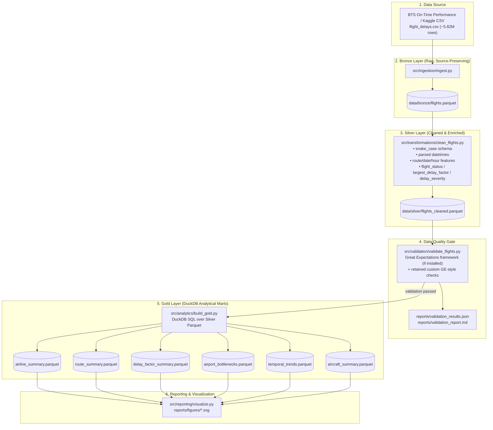

# Flight Delay Lakehouse – Architecture Documentation

## 1. Architectural Overview
The Flight Delay Lakehouse follows a **Medallion Lakehouse Architecture** (Bronze → Silver → Gold) implemented with Python, Parquet, DuckDB, and Apache Airflow. The design separates raw ingestion, transformation/enrichment, data quality validation, analytical mart generation, and reporting.

---

## 2. Layer Responsibilities

### Bronze Layer (Raw Ingestion)
- **Implementation:** `src/ingestion/ingest.py`
- **Input:** raw CSV (`data/raw/flights.csv` by default)
- **Output:** `data/bronze/flights.parquet` (Snappy)
- **Behavior:** source-preserving conversion to columnar Parquet; preserves source schema/rows and provides storage/read efficiency benefits.

### Silver Layer (Cleaned, Standardized & Enriched)
- **Implementation:** `src/transformations/clean_flights.py`
- **Output:** `data/silver/flights_cleaned.parquet`
- **Key behaviors:**
  - Standardizes column names to `snake_case`
  - Parses HHMM/time fields into datetimes
  - Derives features: `route`, `departure_date`, `departure_hour`, `departure_day_of_week`
  - Computes operational aliases/measures (e.g., `delay_minutes`, actual delay/duration fields)
  - Derives analytics fields: `flight_status`, `largest_delay_factor`, `delay_severity`
  - Adds boolean cause indicators: `is_weather_delay`, `is_carrier_delay`, `is_nas_security_delay`
  - Generates surrogate key `flight_id`

### Data Quality Gate
- **Implementation:** `src/validation/validate_flights.py`
- **Validation approach:**
  - Uses the **Great Expectations framework** when installed to run GX-native expectations
  - Retains **custom GE-style checks** as supplemental validation/fallback behavior
  - Produces machine-readable and human-readable reports (`reports/validation_results.json`, `reports/validation_report.md`)
- **Gate behavior:** if validation fails, the process exits non-zero / raises, preventing downstream Gold processing.
- **Failure testing:** supports `--simulate-failure` to deliberately trip the gate.

### Gold Layer (Analytical Marts)
- **Implementation:** `src/analytics/build_gold.py` (DuckDB over Silver Parquet)
- **Canonical marts produced:**
  1. `airline_summary.parquet` — carrier performance and disruption metrics
  2. `route_summary.parquet` — corridor/route delay summary (top corridors by query)
  3. `delay_factor_summary.parquet` — distribution of `largest_delay_factor`
  4. `airport_bottlenecks.parquet` — origin vs destination delay/operations
  5. `temporal_trends.parquet` — hourly departure trends (0–23)
  6. `aircraft_summary.parquet` — registration (`tail_number`) performance proxy

> Note: additional Gold files may exist from earlier experiments; only the marts above are current canonical outputs of `build_gold.py`.

### Reporting / Visualization
- **Implementation:** `src/reporting/visualize.py`
- **Outputs:** SVG figures in `reports/figures/` based on Gold marts.

---

## 3. Orchestration (Apache Airflow)

### DAG
- **File:** `airflow/dags/flight_delay_pipeline.py`
- **DAG ID:** `flight_delay_lakehouse_pipeline`
- **Schedule:** `@daily` (batch)
- **Catchup:** disabled

### Task flow (strict sequential dependencies)
`ingest_bronze >> clean_transform_silver >> data_quality_validation >> build_gold_marts >> generate_visualizations`

### Task purpose
| Task ID | Function | Purpose |
|---|---|---|
| `ingest_bronze` | `ingest_data` | Convert raw CSV to Bronze Parquet |
| `clean_transform_silver` | `clean_data` | Clean/standardize/derive Silver Parquet |
| `data_quality_validation` | `validate` | Run GX + custom checks; block downstream on failure |
| `build_gold_marts` | `build_gold` | Build DuckDB Gold analytical marts |
| `generate_visualizations` | `generate_all_visualizations` | Produce report figures from Gold marts |

### Reliability and failure handling (implemented)
- **Task-level logging:** wrapper logs task start/success/failure with Airflow context (task/run/try info) and prints status messages.
- **Retries:** configured in DAG default args.
- **Retry delay:** configured via `retry_delay` in default args.
- **Failure notification:** `on_failure_callback=notify_failure` logs failure details and optionally posts to `PIPELINE_ALERT_WEBHOOK` (if set).
- **Downstream blocking:** strict task dependency chain ensures downstream tasks do not execute after upstream failure.
- **Failure-path testing:** DAG runner supports `--simulate-failure` (forces validation failure) for operational testing.

---

## 4. Data Model Alignment (summary)
- The project uses a **star-schema logical model** centered on a flight fact at scheduled-operation grain.
- **Silver** is the physical fact table (`flight_id` surrogate PK; logical FKs such as `airline`, `origin`, `destination`, `departure_date`, `tail_number`).
- **Gold** marts are physical aggregates derived from Silver.
- Full details (conceptual/logical/physical, PK/FK/relationships, implementation alignment) are documented in `docs/data_model.md` and `docs/data_dictionary.md`.

---

## 5. Testing & CI/CD (supporting architecture reliability)
- **Automated tests:** `tests/` (unittest-based) cover ingestion/transform/validation/analytics modules and failure behaviors; Airflow-dependent tests are skipped when Airflow is not installed.
- **CI workflow:** `.github/workflows/ci.yml` installs dependencies, compiles key modules, and runs the test suite. Failures fail the workflow.
- **Scope note:** CI is kept simple (no complex deployment). Data-heavy/full-pipeline runs may require local datasets/artifacts and can be executed separately from lightweight CI checks.

---

## 6. Design Notes / Constraints
- The architecture is optimized for a capstone-scale batch workload using local columnar files and in-process analytics (DuckDB).
- The project intentionally avoids adding unnecessary distributed technologies; improvements focus on correctness, reliability, observability, and documentation consistency.
