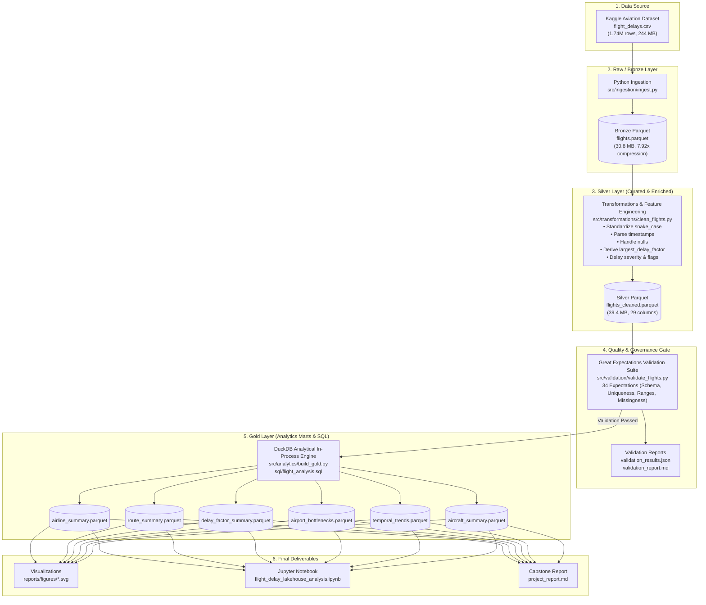

# Flight Delay Lakehouse – Architecture Documentation

## 1. Architectural Overview
The Flight Delay Lakehouse follows the industry-standard **Medallion Lakehouse Architecture** (Bronze → Silver → Gold), decoupling raw ingestion, data curation/cleaning, data quality validation, and high-performance analytical modeling.

---

## 2. Layer Definitions & Design Principles

### Bronze Layer (Raw Ingestion)
- **Format:** Apache Parquet with Snappy compression.
- **Source Integrity:** Strictly source-preserving. Preserves original column names (`FlightID`, `DelayMinutes`, etc.), data types, and row order.
- **Performance:** Reduces raw CSV storage from 244.19 MB down to 30.82 MB (87.4% reduction, 7.92x compression ratio). Enables columnar reading speeds >10x faster than raw CSV parsing.

### Silver Layer (Cleaned, Standardized & Enriched)
- **Format:** Apache Parquet.
- **Schema Standardization:** Column headers converted to uniform `snake_case`.
- **Typing:** String timestamps converted into native `datetime64[ns]` fields.
- **Feature Engineering:**
  - `route`: Synthetic corridor key (`origin-destination`).
  - `departure_date`, `departure_hour`, `departure_day_of_week`.
  - `actual_departure_delay_minutes`, `actual_arrival_delay_minutes`, `actual_flight_duration_minutes`.
  - `flight_status`: Categorizes flights into `operated`, `cancelled`, `diverted`, and `cancelled_and_diverted`.
  - `largest_delay_factor`: Classifies the primary factor causing flight disruption or delay.
  - `delay_severity`: Categorizes delays into `On-Time`, `Minor Delay (1-15 min)`, `Moderate Delay (16-30 min)`, and `Severe Delay (>30 min)`.
  - Cause breakdown flags: `is_weather_delay`, `is_carrier_delay`, `is_nas_security_delay`.
- **Missingness Handling:** Structurally preserves missing `delay_reason` because nulls represent on-time flights (`delay_minutes <= 0`), preventing false imputation.

### Quality Gate (Great Expectations)
- **Framework:** Great Expectations standard specification.
- **Blocking Gate:** Downstream Gold layer execution is halted if any data quality check fails.
- **Coverage:** 34 distinct assertions spanning row volume, schema integrity, entity non-null constraints, primary key uniqueness, numerical boundaries (-10 to 30 min delay), and missingness threshold limits.

### Gold Layer (Analytical Dimensional Marts)
- **Engine:** DuckDB in-process columnar SQL engine.
- **Marts:**
  1. `airline_summary`: Carrier on-time performance, average delay, cancellation, and diversion metrics.
  2. `route_summary`: 25 flight corridors ranked by delay severity and operational volume.
  3. `delay_factor_summary`: Overall fleet breakdown of primary disruption factors.
  4. `airport_bottlenecks`: Origin departure delays versus destination arrival delays across 9 major airport hubs.
  5. `temporal_trends`: Hourly departure congestion curve across 24 hours.
  6. `aircraft_summary`: Fleet reliability by aircraft type (Boeing 737, Boeing 777, Airbus A320).
