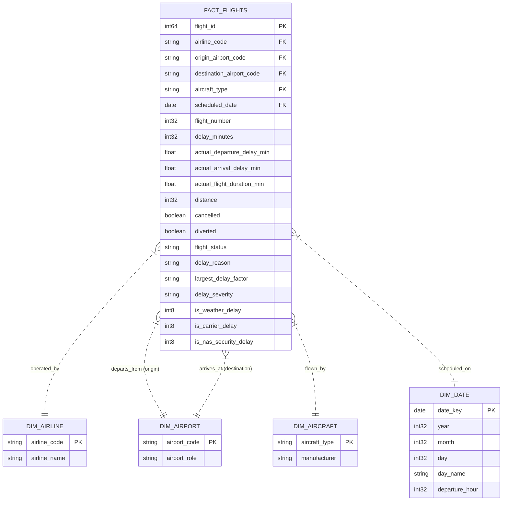

# Flight Delay Lakehouse – Data Model & Schema Design

## 1. Dimensional Star Schema
The Flight Delay Lakehouse uses a Star Schema design optimized for OLAP aggregations in DuckDB and columnar query performance.

---

## 2. Table Specifications

### Fact Table: `fact_flights` (Stored in `data/silver/flights_cleaned.parquet`)
- **Granularity:** One record per scheduled flight operation.
- **Grain Count:** 1,747,627 records.
- **Key Fields:**
  - `flight_id`: Unique identifier (1 to 1,747,627).
  - Foreign dimensions: `airline`, `origin`, `destination`, `aircraft_type`, `departure_date`.
- **Measures:**
  - `delay_minutes`: Primary recorded delay duration (-10 to +30 min).
  - `actual_departure_delay_minutes`: Scheduled vs actual departure differential.
  - `actual_arrival_delay_minutes`: Scheduled vs actual arrival differential.
  - `actual_flight_duration_minutes`: Elapsed in-air time.
  - `distance`: Stage length in miles (131 to 2,980 miles).
- **Categorical & Derived Attributes:**
  - `flight_status`: `operated`, `cancelled`, `diverted`, `cancelled_and_diverted`.
  - `largest_delay_factor`: Derived primary contributor.
  - `delay_severity`: Categorical classification (`On-Time`, `Minor Delay (1-15 min)`, `Moderate Delay (16-30 min)`).
  - `is_weather_delay`, `is_carrier_delay`, `is_nas_security_delay`.

### Dimension: `dim_airline`
- **Keys:** `American Airlines`, `Delta`, `Southwest`, `United`.
- **Attributes:** Airline Name, Fleet Profile.

### Dimension: `dim_airport`
- **Keys:** 9 distinct IATA codes: `ATL`, `BOS`, `DFW`, `JFK`, `LAX`, `MIA`, `ORD`, `SEA`, `SFO`.
- **Role:** Origin hubs and Destination terminals.

### Dimension: `dim_aircraft`
- **Keys:** `Airbus A320`, `Boeing 737`, `Boeing 777`.
- **Role:** Fleet categorization.
