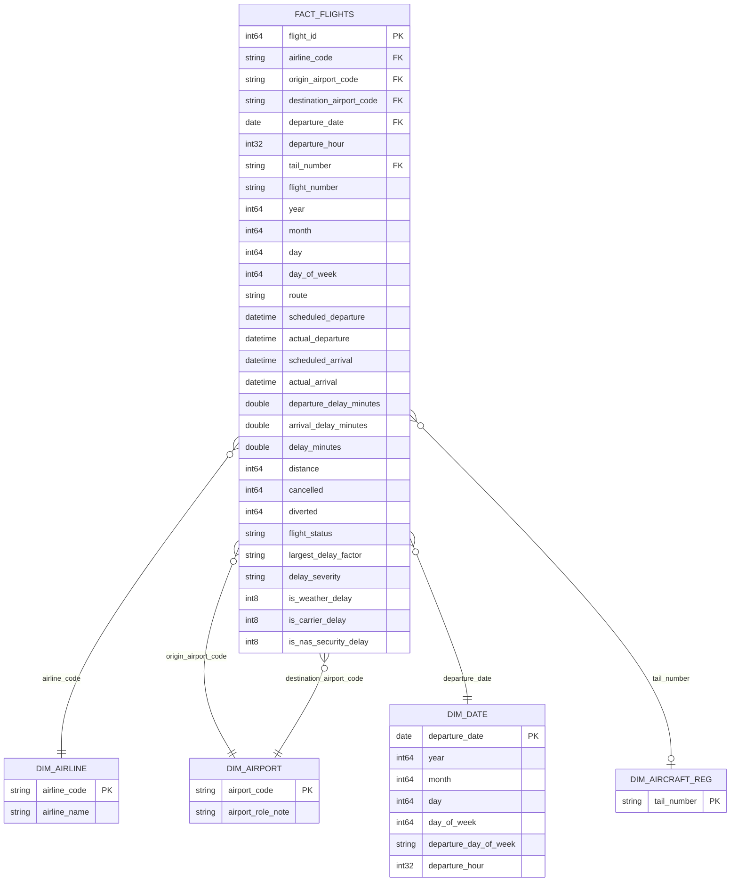

# Flight Delay Lakehouse – Data Model & Schema Design

## 1. Purpose
This document describes the data model used by the Flight Delay Lakehouse and aligns that model with the **implemented** Medallion outputs:

- **Bronze**: source-preserving Parquet (`data/bronze/flights.parquet`)
- **Silver**: cleaned/typed/enriched fact-like Parquet (`data/silver/flights_cleaned.parquet`)
- **Gold**: analytical summary marts (`data/gold/*.parquet`) built by `src/analytics/build_gold.py`

The project uses a **star-schema analytical model conceptually/logically**, with the Silver dataset acting as the physical fact table and Gold marts acting as physical aggregate/query products. Dimension tables are modeled as logical entities derived from Silver attributes; they are **not all materialized as separate dimension Parquet files** in the current implementation.

---

## 2. Conceptual Data Model
The analytical grain is:

> **One record = one scheduled flight operation** (from BTS On-Time Performance data).

Core business concepts:
- **Flight operation (fact)**: schedule/actual times, delays, distance, status, and derived disruption factors.
- **Airline (dimension)**: operating carrier (IATA code).
- **Airport (dimension)**: origin and destination airports (IATA codes) — a role-playing location concept.
- **Date / schedule context (dimension)**: departure date and scheduled departure hour/day.
- **Aircraft registration (dimension-like attribute)**: `tail_number`. BTS does not publish aircraft type in this dataset, so fleet analysis is limited to registration-level granularity.

Conceptual relationships:
- An airline operates many flights.
- An origin airport departs many flights.
- A destination airport receives many flights.
- A date/schedule context applies to many flights.
- A tail number may appear on many flights.

---

## 3. Logical Data Model (Star Schema)
The logical design centers on `fact_flights` with descriptive dimensions.

### Logical keys and relationships
| Relationship | Fact key (Silver) | Dimension key (logical) | Cardinality | Notes |
|---|---|---|---|---|
| Airline | `airline` | `dim_airline.airline_code` | many-to-one | 14 carriers in current dataset. |
| Origin airport | `origin` | `dim_airport.airport_code` | many-to-one | Role-playing: origin. |
| Destination airport | `destination` | `dim_airport.airport_code` | many-to-one | Role-playing: destination. |
| Departure date/context | `departure_date` (+ time attributes) | `dim_date.departure_date` | many-to-one | Date grain in Silver is calendar date; hour/day are schedule attributes. |
| Aircraft registration | `tail_number` | `dim_aircraft_reg.tail_number` | many-to-zero/one (logical) | Present as an attribute; not a fully curated dimension table. |

**Primary key (fact):** `flight_id` (surrogate key generated during Silver transformation).  
**Foreign keys (logical):** `airline`, `origin`, `destination`, `departure_date`, `tail_number` reference logical dimension entities.

> **Implementation note:** DuckDB/Parquet files in this project do not enforce database-level FK constraints; PK/FK relationships are expressed by transformation logic, validation checks, and this model.

---

## 4. Physical Data Model (Implemented)

### 4.1 Bronze (`data/bronze/flights.parquet`)
- **Purpose:** source-preserving ingestion output.
- **Format:** Parquet (Snappy).
- **Schema:** original BTS columns (31 columns) retained; ingestion coerces selected identifiers to string where appropriate.
- **Physical key:** no surrogate key added; source identifiers preserved as-is.

### 4.2 Silver (`data/silver/flights_cleaned.parquet`) — physical fact table
- **Purpose:** cleaned, typed, enriched analytical base.
- **Format:** Parquet (Snappy), produced by `src/transformations/clean_flights.py`.
- **Grain:** one row per scheduled flight operation.
- **Observed dataset characteristics (current implementation):** ~5,819,079 rows, 44 columns, 14 airlines, 628 origin airports, 629 destination airports, 4,897 distinct tail numbers, dates spanning 2015-01-01 to 2015-12-31.
- **Primary key:** `flight_id` (`int64`, surrogate, unique, non-null).
- **Core attributes/measures (implemented names):**
  - Keys/identifiers: `flight_id`, `airline`, `flight_number`, `tail_number`, `origin`, `destination`, `route`
  - Schedule/calendar: `year`, `month`, `day`, `day_of_week`, `departure_date`, `departure_hour`, `departure_day_of_week`, `scheduled_departure`, `actual_departure`, `scheduled_arrival`, `actual_arrival`
  - Delay/operations: `departure_delay_minutes`, `arrival_delay_minutes`, `delay_minutes` (alias), `actual_departure_delay_minutes`, `actual_arrival_delay_minutes`, `actual_flight_duration_minutes`, `distance`, `taxi_out_minutes`, `taxi_in_minutes`, `scheduled_time_minutes`, `elapsed_time_minutes`, `air_time_minutes`
  - Disruption/cause: `cancelled`, `diverted`, `cancellation_reason`, `air_system_delay_minutes`, `security_delay_minutes`, `airline_delay_minutes`, `late_aircraft_delay_minutes`, `weather_delay_minutes`, `flight_status`, `largest_delay_factor`, `delay_severity`, `is_weather_delay`, `is_carrier_delay`, `is_nas_security_delay`

> **Alignment note:** Earlier drafts referenced columns such as `scheduled_date`, `flight_duration`, and `is_aircraft_fault`. The implemented Silver schema uses the names listed above (e.g., `departure_date`, `actual_flight_duration_minutes`, `is_carrier_delay`). See `docs/data_dictionary.md` for the authoritative column list.

### 4.3 Gold (`data/gold/*.parquet`) — physical analytical marts
Built by `src/analytics/build_gold.py` using DuckDB over Silver.

| Mart (implemented) | Grain | Key/grouping columns | Purpose |
|---|---|---|---|
| `airline_summary.parquet` | 1 row per airline | `airline` | Carrier performance, delays, cancellations/diversions, cause counts. |
| `route_summary.parquet` | 1 row per route (top corridors in query) | `route`, `origin`, `destination` | Corridor delay/performance summary. |
| `delay_factor_summary.parquet` | 1 row per delay factor | `largest_delay_factor` | Distribution of primary disruption factors. |
| `airport_bottlenecks.parquet` | 1 row per airport | `airport_code` | Origin/departure vs destination/arrival bottlenecks. |
| `temporal_trends.parquet` | 1 row per departure hour | `departure_hour` | Diurnal delay/congestion profile. |
| `aircraft_summary.parquet` | 1 row per tail number | `tail_number` | Registration-level fleet performance proxy. |
| `dim_airline.parquet` | 1 row per airline code | `airline_code` | Physical dimension table (materialized). |
| `dim_airport.parquet` | 1 row per airport code | `airport_code` | Physical dimension table (materialized). |

Additional Gold files may exist from earlier experiments/runs (for example `delay_by_hour.parquet`, `delay_by_aircraft.parquet`, `delay_reason_summary.parquet`), but they are **not produced by the current `build_gold.py` implementation** and should be treated as non-canonical unless regenerated/added intentionally.

---

## 5. Consistency & Validation Mapping
The model is supported by implementation checks:

- **Silver schema/quality checks:** `src/validation/validate_flights.py` validates required columns, `flight_id` uniqueness/non-null, allowed domain values (`airline`, `flight_status`, `delay_severity`), ranges, and missingness thresholds.
- **Gold integrity tests:** `tests/test_analytics.py` verifies canonical marts exist and key invariants (e.g., airline on-time/delayed counts do not exceed totals).
- **Lineage:** Gold marts are derived from Silver Parquet; validation acts as a quality gate before downstream analytics in the pipeline.

This keeps the documented model consistent with the actual tables and columns produced by the project.
