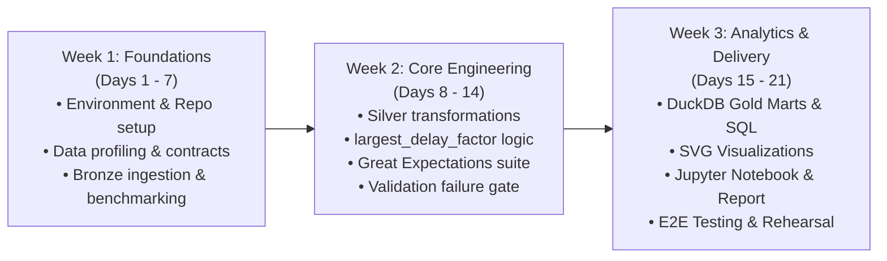

# Flight Delay Lakehouse – Team Handbook & Implementation Guide

> **Submission Due Date:** 09/11/26  
> **Capstone Project:** Modern Lakehouse Aviation Data Engineering Pipeline  
> **Team Size:** 5 Members (Collaborative & Cross-functional)

---

## 1. Project Goal & Motivation
The objective of the **Flight Delay Lakehouse** project is to build a compact, robust, and realistic data engineering pipeline reflecting modern lakehouse architectures using publicly available aviation data from Kaggle (1,747,627 flight records).

The pipeline demonstrates:
- How large-scale aviation datasets are ingested into columnar formats (Parquet).
- How data cleaning, normalization, and feature derivation (such as `largest_delay_factor`) are implemented.
- How data quality is enforced with Great Expectations before data is promoted.
- How high-speed SQL analytics with DuckDB surface actionable operational insights for airline and airport stakeholders.

---

## 2. 5-Member Team Work Breakdown

As outlined in the project planning notes, responsibilities are split into 5 core areas with roughly equal effort, while ensuring continuous integration and collaboration:

| Member | Focus Area | Core Responsibilities & Owned Components | Primary Artifacts |
| :---: | :--- | :--- | :--- |
| **Member 1** | **Data Ingestion & Storage** | • Download & inspect raw Kaggle CSV dataset. • Build Python ingestion script (`src/ingestion/ingest.py`). • Convert raw CSV to source-preserving Bronze Parquet (`data/bronze/flights.parquet`). • Profile schema, row counts, memory footprint, and measure CSV vs Parquet compression & read speed benchmarks. | `src/ingestion/ingest.py` `notebooks/inspect_data.py` `tests/test_ingestion.py` |
| **Member 2** | **Data Cleaning & Transformation** | • Design cleaning logic in `src/transformations/clean_flights.py`. • Standardize column names to snake_case. • Parse and validate timestamps. • Investigate `delay_reason` missingness (identifying structural nulls for on-time flights). • Derive spatial corridors (`route`), temporal fields (`departure_hour`), and the core feature: **`largest_delay_factor`**. • Produce curated Silver Parquet (`data/silver/flights_cleaned.parquet`). | `src/transformations/clean_flights.py` `tests/test_transformations.py` |
| **Member 3** | **Data Validation (Great Expectations)** | • Define and implement the 34-rule Great Expectations suite (`src/validation/validate_flights.py`). • Enforce schema consistency, primary key uniqueness, value sets, range boundaries, and missingness thresholds. • Implement blocking quality gate that prevents downstream Gold generation on failure. • Generate machine-readable JSON (`reports/validation_results.json`) and human-readable Markdown (`reports/validation_report.md`) reports. | `src/validation/validate_flights.py` `reports/validation_report.md` `tests/test_validation.py` |
| **Member 4** | **Querying & Analysis (DuckDB + SQL)** | • Configure DuckDB analytical engine against Silver Parquet. • Author dimensional Gold Mart generation script (`src/analytics/build_gold.py`). • Write comprehensive SQL analytics (`sql/flight_analysis.sql`) answering key operational questions: worst routes, carrier rankings, diurnal hourly patterns, and airport bottlenecks. • Produce 6 materialized Gold Parquet marts in `data/gold/`. | `src/analytics/build_gold.py` `sql/flight_analysis.sql` `tests/test_analytics.py` |
| **Member 5** | **Reporting, Visualisation & Orchestration** | • Build visualization generator (`src/reporting/visualize.py`) exporting crisp vector SVGs. • Author and test the Apache Airflow DAG (`airflow/dags/flight_delay_pipeline.py`) with task dependencies and failure simulation. • Create and execute Jupyter Notebook (`notebooks/flight_delay_lakehouse_analysis.ipynb`). • Author final Capstone Report (`reports/project_report.md`) and project documentation (`docs/`, `README.md`). | `src/reporting/visualize.py` `airflow/dags/flight_delay_pipeline.py` `notebooks/*.ipynb` `reports/project_report.md` `README.md` |

---

## 3. How to Make It Perfect: 21-Day Execution Roadmap

### Key Principles for Capstone Excellence:
1. **Plan Early & Agree on Data Contracts:** Confirm column names, types, and semantics on Day 1 so parallel work does not conflict.
2. **Version Control Discipline:** Frequent commits, clear pull requests, and keep large datasets out of Git (`.gitignore`).
3. **Clean, Modular Code:** Isolate ingestion, transformation, validation, analytics, and reporting into clear Python packages under `src/`.
4. **Data Quality Rigor:** Treat data quality as an automated gate, not an afterthought. Always demonstrate that bad data stops downstream processing.
5. **Meaningful Visualizations:** Avoid vanity charts; create actionable visualizations showing carrier delay rankings, worst flight corridors, hourly curves, and root causes.
6. **End-to-End Testing:** Automate all testing via `python -m unittest discover tests/`.

---

## 4. Course Syllabus Alignment

| Syllabus Concept | Project Implementation |
| :--- | :--- |
| **Data Engineering Lifecycle** | Full flow from raw CSV ingestion → Bronze storage → Silver cleaning → Data Quality Gate → Gold dimensional marts → Analytics & Dashboards. |
| **Lakehouse Architecture (Medallion)** | Layered storage (`data/raw/` → `data/bronze/` → `data/silver/` → `data/gold/`) separating concerns and preserving lineage. |
| **Columnar Storage & Serialization** | Apache Parquet with Snappy compression yielding an 87.4% reduction in disk storage (7.92x compression) and sub-second analytical scans. |
| **Data Quality & Governance** | Great Expectations implementation enforcing 34 business rules, generating formal validation summaries, and blocking pipeline execution on failure. |
| **Modern OLAP Analytical SQL** | In-process columnar DuckDB queries utilizing CTEs, window functions (`DENSE_RANK()`), aggregations, and dimensional star schema views. |
| **Pipeline Orchestration** | Apache Airflow DAG (`airflow/dags/flight_delay_pipeline.py`) with strict task dependencies, task logging, and automated quality failure handling. |
| **Testing & CI/CD** | Complete automated test suite (`tests/`) covering unit tests, schema invariants, quality gates, and E2E execution. |

